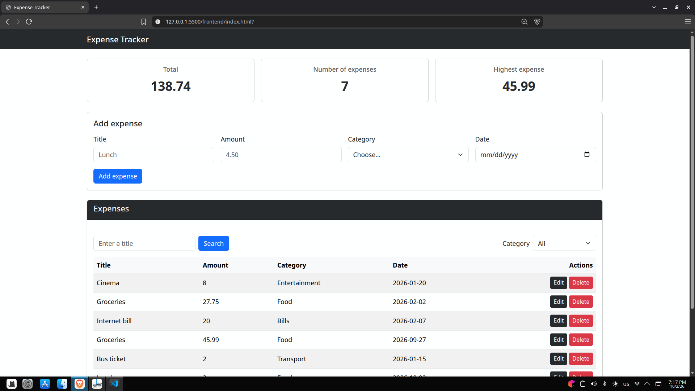
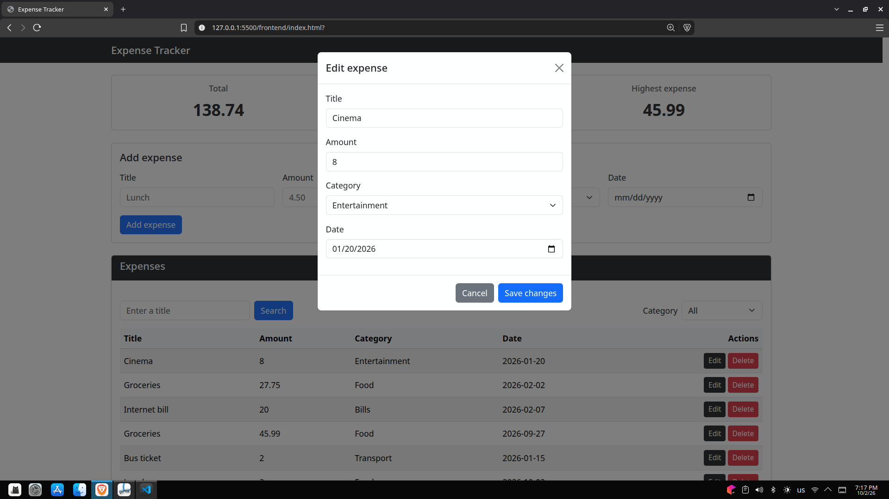

# Expense Tracker

A full-stack expense tracker where you can add, edit, delete, filter, and search your expenses, with a live summary of your spending. The backend is a REST API (Node.js, Express, PostgreSQL) and the frontend is a single-page UI (HTML, Bootstrap, vanilla JavaScript).

## How to run

Prerequisites: Node.js, PostgreSQL, and VS Code (with the **Live Server** extension).

### Backend

1. Create a PostgreSQL database named `expense_tracker`:
   ```sql
   CREATE DATABASE expense_tracker;
   ```
2. Run `schema.sql` on it:
   ```bash
   psql -U postgres -d expense_tracker -f schema.sql
   ```
3. Copy `.env.example` to `.env` and fill in your values:
   ```env
   DB_HOST=localhost
   DB_USER=postgres
   DB_PASSWORD=your_password
   DB_NAME=expense_tracker
   DB_PORT=5432
   ```
4. Install dependencies:
   ```bash
   npm install express cors pg dotenv
   ```
5. Make sure `package.json` contains `"type": "module"` (the project uses ES modules).
6. Start the server:
   ```bash
   node server.js
   ```
   The API runs on `http://localhost:3000`.

### Frontend

1. Make sure the backend is running on `http://localhost:3000`.
2. Open `frontend/index.html` with the VS Code **Live Server** extension (usually `http://127.0.0.1:5500`).

The API base URL is defined at the top of `frontend/js/app.js`:
```js
const API_URL = "http://localhost:3000/api/expenses";
```

## Features

- [x] Add an expense (with validation)
- [x] Delete an expense
- [x] Edit an expense
- [x] Filter by category
- [x] Summary cards (total, count, highest)
- [x] Data is saved in a PostgreSQL database

Extras: search by title, loading spinner, and error alerts.

## Screenshots





## Backend

REST API built with **Node.js**, **Express**, and **PostgreSQL** (using the `pg` library).

**Tech stack:** Node.js + Express, PostgreSQL (`pg` Pool), `dotenv` for environment variables, `cors` to allow requests from the frontend.

### Endpoints

| Method | Endpoint            | Description       | Success | Errors        |
|--------|---------------------|-------------------|---------|---------------|
| GET    | `/api/expenses`     | Get all expenses  | 200     | 500           |
| GET    | `/api/expenses/:id` | Get one expense   | 200     | 400, 404, 500 |
| POST   | `/api/expenses`     | Add a new expense | 201     | 400, 500      |
| PUT    | `/api/expenses/:id` | Update an expense | 200     | 400, 404, 500 |
| DELETE | `/api/expenses/:id` | Delete an expense | 200     | 400, 404, 500 |

### Expense Object

```json
{
  "id": 1,
  "title": "Groceries",
  "amount": 27.75,
  "category": "Food",
  "date": "2026-02-02"
}
```

The `id` is generated by the database and is never sent by the client.

### Validation Rules (POST / PUT)

- `title`: required, non-empty string
- `amount`: a number greater than 0
- `category`: one of `Food`, `Transport`, `Bills`, `Entertainment`, `Other`
- `date`: a valid date (e.g. `2026-02-02`)
- `id` (in the URL): must be a valid number

Invalid requests return `400` with a message explaining the problem:
```json
{ "message": "Amount must be a positive number" }
```

### Example Requests

**Add an expense**
```http
POST /api/expenses
Content-Type: application/json

{
  "title": "Lunch",
  "amount": 4.5,
  "category": "Food",
  "date": "2026-02-10"
}
```

**Delete an expense**
```http
DELETE /api/expenses/3
```
```json
{ "message": "expenses deleted succsesfully " }
```

### Implementation Notes

- All queries are **parameterized** (`$1, $2, ...`) to prevent SQL injection.
- `RETURNING` is used on `INSERT`, `UPDATE`, and `DELETE` to get the affected row back.
- PostgreSQL returns `NUMERIC` as text and `DATE` as a JS `Date`, so the queries use `amount::float` and `to_char(date, 'YYYY-MM-DD')` to return clean JSON values.
- Unexpected errors are logged on the server and return a generic `500` response.
- All endpoints were tested with Thunder Client before connecting the frontend.

## Frontend

Single-page UI built with **HTML**, **Bootstrap 5.3**, and **vanilla JavaScript**. It talks to the backend through `fetch` with `async/await`. There is no in-memory or `localStorage` layer: the server is the single source of truth.

**Tech stack:** HTML5 + Bootstrap 5.3 (CDN), vanilla JavaScript (ES6+), custom CSS for the summary grid layout.

### Project Structure

```
frontend/
├── index.html
├── css/
│   └── style.css
└── js/
    └── app.js
```

### Features

- **Summary cards**: total amount, number of expenses, and highest expense, updated from the data returned by the API. They use a responsive CSS Grid (`repeat(auto-fit, minmax(220px, 1fr))`).
- **Expenses table**: rows are built with DOM methods and `textContent`, so user input is never injected as HTML.
- **Add expense**: form with title, amount, category, and date.
- **Edit expense**: opens a Bootstrap modal pre-filled with the selected expense, then sends a `PUT` request.
- **Delete expense**: sends a `DELETE` request from the row's button.
- **Filter by category**: dropdown that filters the list on the client side.
- **Search by title**: search input next to the table.
- **Loading and errors**: a Bootstrap spinner while loading, and an alert if a request fails.

### How It Works

| Function                      | Purpose                                                              |
|-------------------------------|----------------------------------------------------------------------|
| `getExpenses()`               | `GET` all expenses, with spinner and error handling                  |
| `addExpense()`                | Reads the form and sends a `POST` request                            |
| `updateExpense(id, data)`     | Sends a `PUT` request                                                |
| `deleteExpense(id)`           | Sends a `DELETE` request                                             |
| `renderTableAndSummury()`     | Fetches the list, applies the category filter, renders table + summary |
| `renderOneElement(el, tbody)` | Builds one table row with its Edit and Delete buttons                |
| `renderSummary(list)`         | Updates the three summary cards                                      |
| `fillFormForEdit(expense)`    | Fills the edit modal and shows it                                    |

After every add, edit, or delete, the page re-fetches the list from the server, so the table always shows what was actually saved. Rows are never updated by hand.

### Notes

- The backend must allow CORS (it does, via the `cors` package).
- Dates use the `YYYY-MM-DD` format, matching the API response.

## What was the hardest part?

<!-- A short paragraph: what got you stuck, and how did you solve it? -->
The hardest part for me was building a proper frontend layout. It is one of my weaknesses in programming, and I spent a lot of time on it. I even re-read the Bootstrap docs to learn how to use it properly, even though I had already learned it through my training. The backend was the easiest part for me.